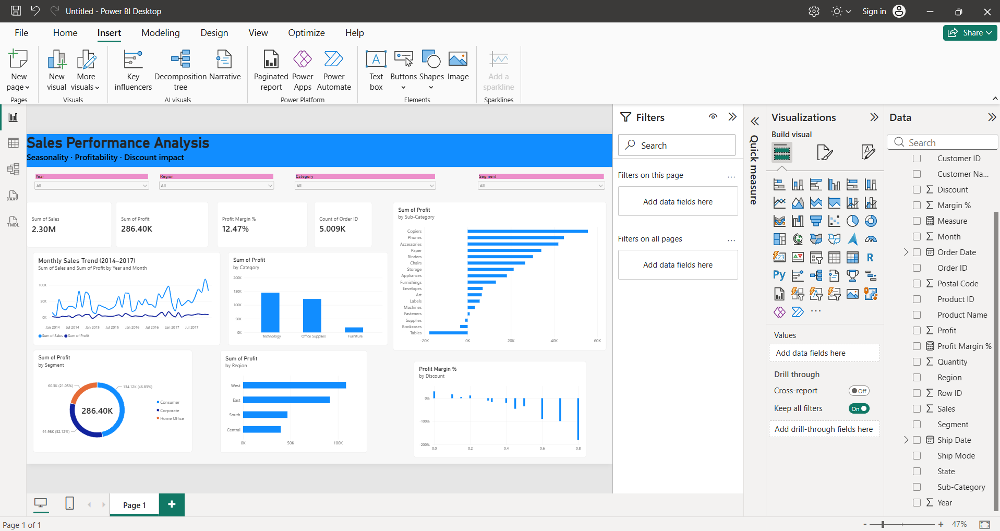

# Superstore Sales Performance Analysis

## Project Overview
An end-to-end data analytics project analysing Superstore sales, profit, customer segments, regional performance, product categories, and discount impact using Python, MySQL, and Power BI.

## Objectives
- Analyse sales and profit trends from 2014 to 2017.
- Identify the most profitable product categories and sub-categories.
- Compare profitability across customer segments and regions.
- Evaluate how discount levels affect profit margins.
- Identify top-performing and loss-making products.

## Tools & Technologies
- **Python:** Pandas, NumPy, Matplotlib, Seaborn
- **SQL:** MySQL
- **Visualization:** Power BI
- **Data:** Sample Superstore Dataset

## Project Workflow
1. **Python:** Data inspection, cleaning, exploratory data analysis, and visualizations.
2. **MySQL:** SQL analysis using aggregation, grouping, date functions, and ranking queries.
3. **Power BI:** Interactive dashboard with KPIs, charts, and slicers.

## Key Findings
- Total sales: approximately $2.30 million.
- Total profit: approximately $286.40 thousand.
- Overall profit margin: 12.47%.
- Technology generated the highest category profit.
- Furniture had a comparatively low profit margin.
- The West region generated the highest regional profit.
- Higher discount levels were associated with weaker profit margins.

## Dashboard

## Project Files
- `sales_clean.csv` – Cleaned dataset
- `superstore_analysis.sql` – SQL analysis queries
- `import_to_mysql.py` – Python script to import data into MySQL
- `Superstore_Sales_Analysis.pbix` – Power BI dashboard
- `superstore_dashboard.png` – Dashboard screenshot
- Python analysis script – Data cleaning and exploratory analysis

## Conclusion
This project demonstrates an end-to-end data analytics workflow, from data preparation and SQL querying to interactive dashboard development and business insights.